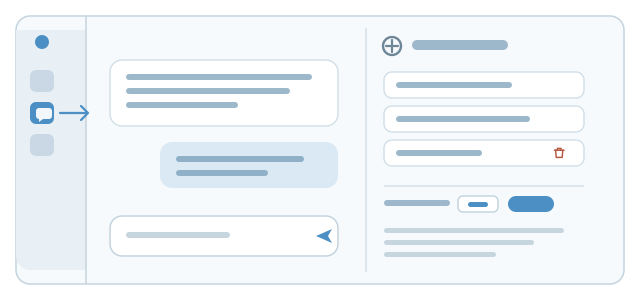

# dsh-only-chat

Only Chat for [DeepSeek Harness](https://github.com/deepseek-ai): one sidebar click gives you a chat
with any model, with no workspace to pick — the way a model vendor's web app behaves.



## What you get

**One click, one chat.** The sidebar entry **Only Chat** (仅聊天) starts a chat immediately and opens
it in the main panel with the usual composer, model picker, and message actions. Clicking it again
reuses the empty chat instead of stacking up blank ones.

**Same preset, read-only.** A chat runs the deployment's own default Agent
preset — the same capabilities as an ordinary session, including skills, commands, jobs, schedules,
goals, planning, compaction, subagents, workflows, web, and office tools. What differs is one thing:
the chat cannot change your machine.

- The Session pins the deployment's `read-only` permission preset, so the composer shows the chat as
  read-only and the sandbox refuses any file change a command attempts.
- `write`, `edit`, and `apply_patch` are refused, along with MCP tools (`mcp__…`), the profile editors
  (`plugin_manager`, `plugin_market`), the package runner (`cordis_run`, `cordis_define`, …), and
  `working_directory`. These are refused at execution time in the chat's own Agent scope, so a tool
  that registers later is refused too. Writers still appear in the catalog because the preset registers
  them; calling one returns a refusal that says the chat is read-only.

Read tools reach any path the Harness can read — including files under your home directory. That is
deliberate: it is what makes "read this file for me" work with no workspace.

**Chat mode has its own list.** While a chat is open, the sidebar's browsing region is this plugin's
flat chat list — the same rows the host uses (title, relative time, a running dot, hover actions), drawn
against the sidebar's one left gutter so the rows use the full width: keep
(pin — sorts the chat to the top of both lists and exempts it from the limit), convert to a session,
delete. Clicking a row opens that chat. A chat you have not written in yet
is not listed: it is the draft you are looking at, and it still counts toward the limit. **Settings →
Only Chat** shows the same list plus delete-all, the chat folder, and the `maxChats` limit; the kept
count there includes the draft.

Deleting the chat that is open in the main panel moves the panel to the next chat, or back to your most
recently active ordinary session when no other chat is left.

The limit keeps at most `maxChats` chats, 20 by default. Starting a chat past the limit deletes the
least recently active idle chats; a chat still generating is left alone, and a **kept** chat (the pin
icon) is never retired — pinning chats can put the total above the limit, and that is on purpose.
Lowering the limit deletes nothing by itself: the pruning happens on the next chat you start, and the
page tells you how many that would remove. Saving the number writes `maxChats` into your profile patch
through the Harness configuration editor.

Chats are never archived: an archived chat would vanish from both lists with no way back, and the
archive/pin buttons of the host session rows live in child slots this plugin may not re-declare, so
those three controls are drawn by the plugin over its own list instead.

Or set it in the patch yourself:

```yaml
- id: only-chat
  name: dsh-only-chat
  config:
    maxChats: 50
    chatDirectory: /absolute/path/to/chats
  # `chatDirectory` must sit below the Harness home; a path at or above it is refused at activation.
```

**Convert a chat into a normal session.** The Settings page copies a chat's conversation into a new
session in a workspace you choose, restores the deployment's default preset and permission on that
copy, and deletes the chat. This is one-way: a normal session is not a chat and cannot be turned back
into one.

Deleting a chat tears down its Agent, detaches the live Session, removes the session-owned log
directory, and clears its projection checkpoint. That is not recoverable. Disabling the plugin only
hides the entry and the Settings section; existing logs stay put.

## Install

From a checkout:

```sh
git clone https://github.com/wold9168/dsh-only-chat.git
dsh plugin --profile <your-profile> add ./dsh-only-chat
```

Or in the Web GUI: **Plugins** → **Add plugin** → point at the `dsh-only-chat` directory. Reload the
page afterwards, then restart the Harness if the entry still does not appear.

Requires a web-served profile: the browser half declares `dsh.client.platform: "web"`.

## How it is wired

| File | Role |
|---|---|
| `index.js` | Host half: the chat directory, ownership checks, the read-only permission pin, the bounded history, conversion, and routes under `/api/dsh-only-chat`. |
| `guard.js` | Preset-scoped tool policy: hides host-layer tools from a chat's scope and denies anything outside the read-only allow-list at execution time. |
| `client.js` | Browser half: the `sidebar.panellist` entry, the `main` panel that starts the chat, and the `settings.section` page. Plain JavaScript plus React from the page's module table. |
| `cordis.patch.yml` | Bundle layer: the one plugin row. No preset is declared — chats run yours. |

Chats are ordinary Harness Sessions whose header names this plugin's directory, so history is never
copied: the Settings list reads the shared Session catalog and filters it. Ownership requires that
directory and no parent session — pointing `chatDirectory` at an existing project cannot make this
plugin delete someone else's sessions.

One thing you will notice: chats need a Workspace. The host conversation surface treats an empty
Session that belongs to no Workspace as "choose a workspace first" — the composer stays inert until you
pick one. So the plugin registers a Workspace over its own chat directory while you are chatting, and
drops that registration when you leave. That gives two separate modes:

- **Only Chat mode** — the main panel holds one of the plugin's chats. The sidebar's browsing region is
  replaced by this plugin's chat list (header with New chat, flat chat rows), so no other workspace or
  session is visible there.
- **Normal mode** — the host workspace browser comes back, and the Only Chat row is gone from it because
  its registration was removed. Chat logs stay on disk and stay listed under Settings → Only Chat.

The sidebar entry is the switch: clicking it in normal mode re-registers the Workspace, re-accounts the
chats to it, and opens one; while a chat is open the same entry reads **Back to workspaces** and opens
your most recently active ordinary session instead.

While a chat is open, the New Session hero's workspace chip and preset selector render nothing, so the
interface offers no other workspace to pick. The read-only layer is applied on the Host to every Agent
whose Session sits in the chat directory, which covers subagents a chat spawns as well. The Settings
list reads the Host's own chat list, so it shows exactly what it can delete.

Routes are gated twice: the composition's own trust fence, then the authenticated browser Peer. An API
token client gets `403`; only a person at the interface can start, convert, or delete a chat.

## Development

```sh
pnpm run check   # node --check on the three source files; no build step
```

Both halves ship as written — there is no compile step. Chats run your default preset, so editing that
preset (Settings → Agent presets) changes what a chat can do; the read-only refusals stay on top. To
refuse more tools, add their names to `REFUSED_TOOLS` in `index.js`.

## Known limits

- Workspace chrome a normal session has (files panel, workspace header) is host UI. Only Chat sessions
  belong to no workspace, so they appear only in this plugin's Settings page.
- A chat still inside a turn is never deleted by the automatic limit; deleting one yourself while it is
  generating cancels it. A kept (pinned) chat is exempt from the limit too, so the total can exceed it.
- A chat with no messages yet is kept out of both lists, so an abandoned draft is only visible through
  the limit count; it is still a Session on disk until the limit retires it or you start another chat.
  Being "no messages yet" is only known while the Session is live, so a retired empty chat can show up as
  a row named `New chat`.
- Chats cannot be archived from this plugin: there is no un-archiving surface here, and the host row
  buttons sit in child slots the plugin cannot re-declare.
- Because a chat runs your default preset, tools that write are still listed to the model and refuse
  when called. Remove the `tool-fs` writers from your preset if you want them gone from the catalog.
- Conversion copies the log into a new session: the original chat is deleted and the new session starts
  fresh in the workspace, so it is a new Session identity, not a rename.
- Projection-checkpoint cleanup is best-effort; a small cached record for a deleted chat may remain.
- The entry cannot go back when nothing else exists: with no ordinary session and no other workspace it
  says so instead of starting a chat in the chat directory.
- Changing `chatDirectory` leaves the old directory's logs on disk; clean them yourself.
- Operations are panel-only on purpose. There is no agent tool for starting or deleting chats, so an
  agent cannot erase your history.

## Chinese summary / 中文说明

安装启用后，侧边栏会出现「仅聊天」入口。点一下立刻开始一段不绑定工作区的对话（点第二次会复用还没写过内容
的空聊天），聊天在主面板打开，沿用宿主的输入框与模型选择器。

这些聊天运行你自己的默认 Agent 预设，能力和普通会话一致（技能、命令、后台任务、计划、压缩、子代理、网页、Office
工具都在），唯一区别是只读：会话固定使用部署的 read-only 权限预设，沙箱会拒绝命令对文件的任何改动；`write`、
`edit`、`apply_patch`、MCP 工具（`mcp__…`）、profile 编辑器（`plugin_manager`、`plugin_market`）、包运行器
（`cordis_run` 等）和 `working_directory` 会在聊天自己的 Agent 作用域里被执行前拒绝，因此稍后才连上来的 MCP
工具也一样被拒。写文件类的工具仍会出现在目录里（那是预设注册的），调用时会得到一句「本聊天只读」。

聊天期间侧边栏的浏览区由插件接管，是一份与宿主会话行同形的聊天列表（标题、相对时间、生成中的小圆点，
悬停出现「保留 / 转为正常会话 / 删除」），点行就打开那条聊天。还没说过话的聊天不会
出现在列表里（那就是你正在看的草稿），但它仍然计入保留数量；「还没说过话」只在会话活着时能判断，所以被闲置的空聊天可能作为一行「新聊天」出现。删除当前打开的聊天会把主面板切到下一条聊天，
没有别的聊天就回到你最近使用的普通会话。「设置 → 仅聊天」用的是同一套行渲染，另外还有删除全部、聊天目录和
保留数量上限。

默认最多保留 20 个：超出后新建聊天会删除最久没动的空闲聊天，正在生成的聊天会保留；带图钉（保留）的聊天排在两份列表的最前面，
也不会被上限删除，所以被保留的聊天可以让总数超过上限。调小上限本身不会删除，会在下一次新建时生效，页面上会提示会删掉
几个。保存上限会写入你的 profile patch。聊天不能归档：这里没有取消归档的入口，而宿主会话行上的归档/置顶按钮位于
插件不能重复声明的子插槽里，所以这三个控件由插件自己画在自己的列表里。

退出聊天模式后宿主的浏览区恢复，并且「Only Chat」这个工作区行会被注销，所以正常模式的工作区列表里看不到它。
聊天日志一直在磁盘上，也一直在「设置 → 仅聊天」里列着。

两种模式都靠一次点击切换：侧边栏入口会重新注册工作区、把聊天挂回去并打开一条；「返回工作区」会打开你最近
使用的一条普通会话。

「转为正常会话」会把对话复制到选定工作区里的新会话，恢复成默认预设与默认权限，然后删除这个聊天；这一步不可
逆，普通会话无法再变回聊天。删除聊天会停掉 Agent、分离会话、删除日志目录并清理投影缓存，操作不可恢复。停用
插件只会隐藏入口和设置页，已有日志保持原样。

## License

MIT — see [LICENSE](LICENSE).
